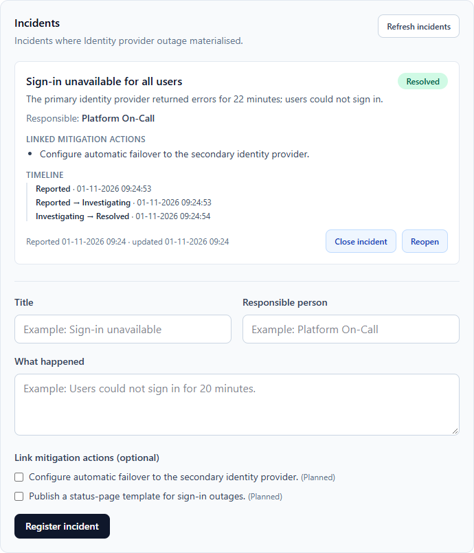

# ResilienceOps

ResilienceOps is a fullstack SaaS portfolio project for managing operational risks and the mitigation actions that reduce them.

It is built step by step, from repository setup through local development, persistence, automated testing, observability and continuous integration, towards deployment on Microsoft Azure. This README describes what is **implemented today** and keeps the **planned** work clearly separate.

## Purpose

The project has two primary purposes:

1. Build a usable application for managing operational risks and incidents.
2. Develop and document practical experience with Angular, .NET, Azure and Application Insights.

Every technical decision should be understandable, documented and defensible in a technical discussion.

## Current status

| Area | Status |
| --- | --- |
| Risk register (create, list, view, status lifecycle) | Implemented |
| Mitigation actions per risk (create, list, view, status lifecycle) | Implemented |
| Incidents per risk (create, link mitigation actions, lifecycle, status timeline) | Implemented |
| Angular dashboard for risks, mitigation actions and incidents | Implemented |
| Persistence with Entity Framework Core and migrations (SQLite) | Implemented |
| API integration tests and Angular unit tests | Implemented |
| GitHub Actions CI (build and test, backend and frontend) | Implemented |
| OpenTelemetry instrumentation with optional Azure Monitor export | Implemented (export only when a connection string is configured) |
| Azure hosting, Azure SQL, Key Vault, automated deployment | Planned |
| Audit log, search and filtering, authentication | Planned |

## Implemented features

### Backend API (ASP.NET Core 10 LTS, Minimal APIs)

- **Health endpoint** reporting status, service name, environment and timestamp.
- **Operational risks** with title, description, severity (`Low`, `Medium`, `High`, `Critical`) and status (`Open`, `Mitigating`, `Closed`).
  - Create, list (newest first) and get by id.
  - Change status through a dedicated endpoint.
  - Two seeded example risks are created by the initial migration.
- **Mitigation actions** linked to a risk, with description, owner, due date and status (`Planned`, `InProgress`, `Completed`).
  - Create, list and get by id under the parent risk.
  - Change status through a dedicated endpoint.
  - Returns `404` when the parent risk does not exist.
  - The database enforces the link with a foreign key to the risk (cascade delete).
- **Incidents** recorded against a risk, with title, description, a responsible person and optional links to that risk's mitigation actions.
  - Lifecycle **Reported → Investigating → Resolved → Closed**; a resolved or closed incident can be reopened (back to Investigating). Any other move, including to the current status, returns `409 Conflict` with the reason.
  - Every status change is appended to an ordered **history** (previous status, new status, time). The incident also keeps the time it was reported, last updated and last investigated, resolved and closed.
  - Linked mitigation actions must belong to the same risk (`400` otherwise); incidents of another risk return `404`.
  - Two requests that change the same incident at the same time cannot both commit: a unique `(IncidentId, Sequence)` index on the history rejects the second, which returns `409`.
- **Validation** of all input, returned as RFC 7807 `ValidationProblem` responses (for example required fields, maximum lengths, valid enum values and due dates in the future).
- **Enums serialized as strings** in JSON.
- **CORS** policy for the local Angular dev server (`http://localhost:4200`).
- **Feature folders** (`Features/Risks`, `Features/Mitigations`, `Features/Incidents`) with a repository abstraction (`IRiskRepository`, `IMitigationRepository`, `IIncidentRepository`) and EF Core implementations.
- **Rich domain entities** with private setters and factory methods (`RiskItem.Create`, `MitigationAction.Create`, `Incident.Create`, `RiskItem.ChangeStatus`, `Incident.ChangeStatus`).

### Persistence

- Entity Framework Core 10 with **SQLite**, stored in `src/ResilienceOps.Api/Data/resilience-ops.db`.
- Migrations are applied automatically at startup (`InitialRiskDatabase`, `AddMitigationActions`, `AddIncidents`). `AddIncidents` only adds tables, so an existing database keeps its risks and mitigation actions when it is upgraded.
- Explicit model configuration: maximum lengths, enums stored as strings, `DateTimeOffset` stored as Unix milliseconds, foreign keys from mitigation actions and incidents to risks, an `IncidentMitigations` link table, an `IncidentHistory` table with a unique `(IncidentId, Sequence)` index, and indexes on `RiskId` and `(RiskId, Status)`.
- `dotnet-ef` is pinned as a local tool in `.config/dotnet-tools.json`.

### Frontend (Angular 21)

- Standalone components, **Angular Signals** for state, **Reactive Forms** with validation messages, and `HttpClient` services per feature.
- **Tailwind CSS 4** for styling.
- Dashboard with an API health card, a risk registration form and the risk register.
- Risk status actions that follow the lifecycle **Open → Mitigating → Closed → (reopen) Open**, with loading states and error messages.
- An expandable **mitigation panel** per risk that lists actions, registers new ones with owner and due date, and moves actions through **Planned → InProgress → Completed → (reopen) Planned**.
- An expandable **incident panel** per risk that registers incidents (with a responsible person and optional linked mitigation actions), shows each incident's status timeline, and offers only the status moves the lifecycle allows. When the API answers `409` (for example because someone else already changed the incident) the panel shows the reason and reloads the stored incident.



### Observability

- OpenTelemetry tracing with the **Azure Monitor distribution** (`Azure.Monitor.OpenTelemetry.AspNetCore`).
- Custom `ActivitySource`s for the risk, mitigation and incident features, with tags such as risk id, severity and status changes.
- Structured logging in the repositories.
- Export to Application Insights is **enabled only when** `APPLICATIONINSIGHTS_CONNECTION_STRING` is set. Without it the API runs normally with console logging.

See [docs/observability.md](docs/observability.md) for the collected telemetry and example Kusto queries.

For a developer-level explanation of the design, request flows, tests and trade-offs, see [docs/PROJECT_WALKTHROUGH.md](docs/PROJECT_WALKTHROUGH.md).

### Testing

- **API integration tests** (`tests/ResilienceOps.Api.IntegrationTests`, xUnit) host the real API with `WebApplicationFactory` against an in-memory SQLite database. Migrations run exactly as in the application. The tests cover listing seeded risks, creating and persisting risks, mitigation actions and incidents, risk, mitigation and incident status changes (including the full incident lifecycle, reopening, ordered history and rejected transitions), validation problems, cross-risk `404` responses, and a race between two incident status changes (a `SaveChangesInterceptor` commits a competing change between load and save).
- **Angular unit tests** (Vitest through the Angular unit-test builder) cover the dashboard component, the mitigation panel and the incident panel with mocked API services.

### Continuous integration

`.github/workflows/ci.yml` runs on pushes to `main` and on all pull requests:

- **.NET API**: restore, build (Release) and test with the SDK pinned in `global.json`. TRX test results are uploaded as an artifact.
- **Angular web**: `npm ci`, production build and unit tests.

## API endpoints

| Method | Route | Description |
| --- | --- | --- |
| `GET` | `/api/health` | Service health |
| `GET` | `/api/risks` | List risks, newest first |
| `GET` | `/api/risks/{id}` | Get a risk |
| `POST` | `/api/risks` | Create a risk |
| `PATCH` | `/api/risks/{id}/status` | Change risk status |
| `GET` | `/api/risks/{riskId}/mitigations` | List mitigation actions for a risk |
| `GET` | `/api/risks/{riskId}/mitigations/{mitigationId}` | Get a mitigation action |
| `POST` | `/api/risks/{riskId}/mitigations` | Create a mitigation action |
| `PATCH` | `/api/risks/{riskId}/mitigations/{mitigationId}/status` | Change mitigation action status |
| `GET` | `/api/risks/{riskId}/incidents` | List incidents for a risk, newest first |
| `GET` | `/api/risks/{riskId}/incidents/{incidentId}` | Get an incident with its history |
| `GET` | `/api/risks/{riskId}/incidents/{incidentId}/history` | Get an incident's status history |
| `POST` | `/api/risks/{riskId}/incidents` | Register an incident |
| `PATCH` | `/api/risks/{riskId}/incidents/{incidentId}/status` | Change incident status (`409` for a move the lifecycle does not allow) |

Example request to register an incident:

```json
POST /api/risks/{riskId}/incidents
{
  "title": "Sign-in unavailable for all users",
  "description": "The primary identity provider returned errors for 22 minutes.",
  "responsiblePerson": "Platform On-Call",
  "mitigationIds": ["<id of a mitigation action of the same risk>"]
}
```

Example request to create a risk:

```json
POST /api/risks
{
  "title": "Identity provider outage",
  "description": "Loss of the identity provider could prevent employees from accessing critical systems.",
  "severity": "Critical"
}
```

## Repository structure

```text
resilience-ops
├── .config/dotnet-tools.json        # Pinned dotnet-ef tool
├── .github/workflows/ci.yml         # CI for API and web
├── docs/                            # Vision, goals, observability, walkthrough, screenshots
├── src
│   ├── ResilienceOps.Api            # ASP.NET Core Minimal API
│   │   ├── Contracts
│   │   ├── Data                     # DbContext and EF Core migrations
│   │   └── Features
│   │       ├── Incidents
│   │       ├── Mitigations
│   │       └── Risks
│   └── resilience-ops-web           # Angular 21 frontend
│       └── src/app
│           ├── core                 # Models and API services
│           └── features             # mitigations and incidents panels
├── tests
│   └── ResilienceOps.Api.IntegrationTests
├── global.json                      # .NET SDK 10.0.402 (latest feature roll-forward)
└── ResilienceOps.sln
```

## Getting started

### Prerequisites

- .NET 10 SDK 10.0.402 or later 10.0 SDK (see `global.json`)
- Node.js 22 and npm 11

### Run the API

```bash
dotnet run --project src/ResilienceOps.Api --launch-profile http
```

The API listens on `http://localhost:5014`. The SQLite database is created and migrated automatically on first start.

### Run the Angular app

```bash
cd src/resilience-ops-web
npm ci
npm start
```

Open `http://localhost:4200`. The frontend calls the API at `http://localhost:5014`.

### Run the tests

```bash
dotnet test ResilienceOps.sln

cd src/resilience-ops-web
npm test -- --watch=false
```

### Optional: send telemetry to Application Insights

```powershell
$env:APPLICATIONINSIGHTS_CONNECTION_STRING = "<connection-string>"
dotnet run --project src/ResilienceOps.Api --launch-profile http
```

Never commit the connection string.

## Planned work

The following items are part of the roadmap and are **not implemented yet**.

### Product features

- Reassigning an incident's responsible person and editing incidents after registration (both are recorded once today)
- Audit log for changes to important records
- Search and filtering
- Authentication and authorization

### Cloud, security and operations

- Deployment to Azure App Service with automated deployment from GitHub Actions
- Azure SQL as the production database (SQLite is used today)
- Azure Key Vault for secrets
- Application Insights dashboards, alerts and production monitoring
- Configurable CORS origins and API base URL per environment

### Quality

- Backend unit tests for domain logic
- End-to-end tests
- FluentValidation (validation is currently implemented manually in the endpoints)

## Development principles

- Implement one understandable step at a time.
- Keep commits small and focused.
- Document important architectural decisions.
- Avoid complexity without a concrete reason.
- Write code that can be tested and maintained.
- Understand every dependency and significant line of code.
